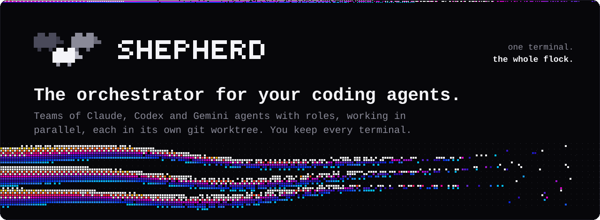
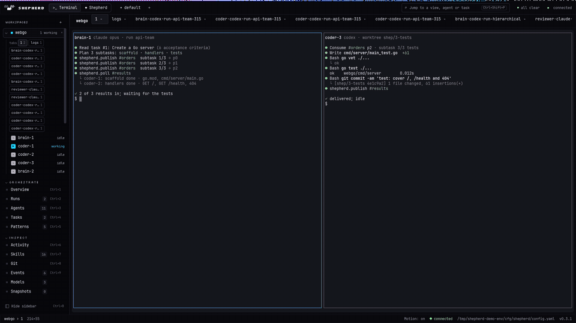
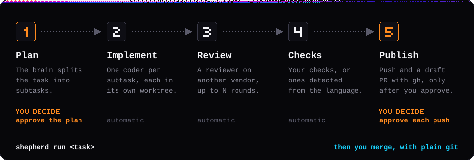
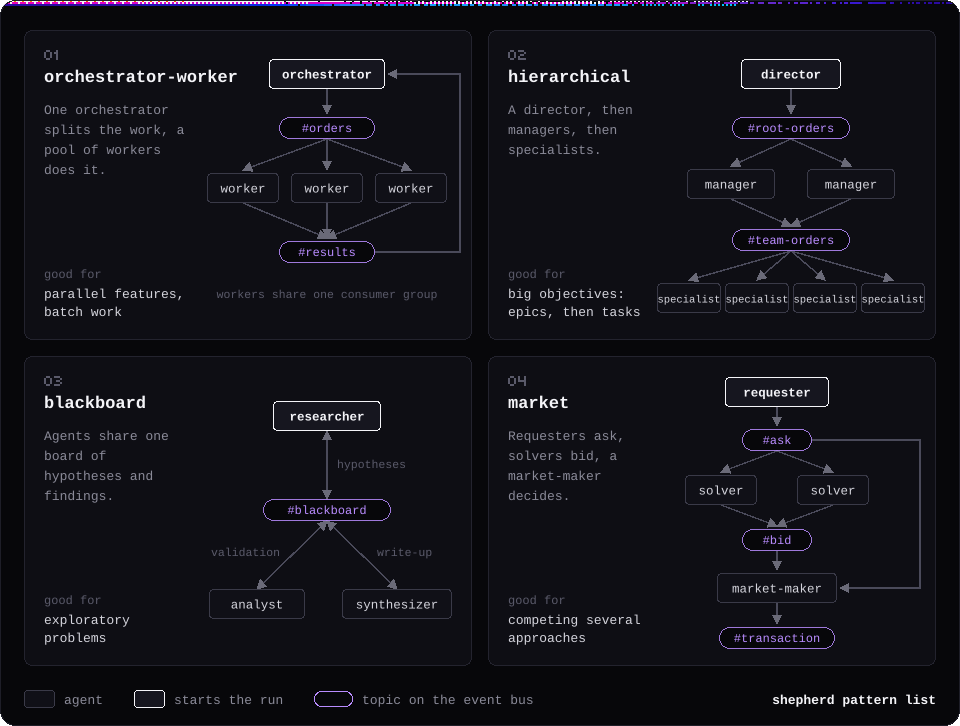
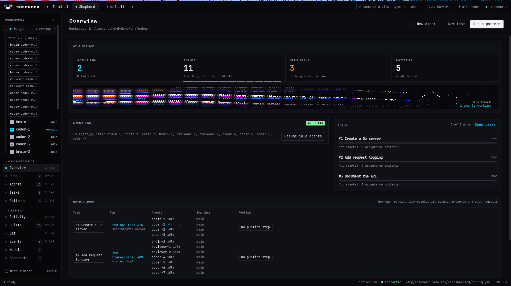
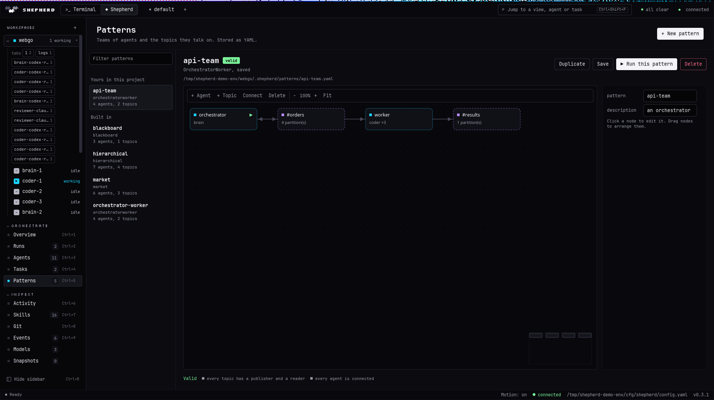
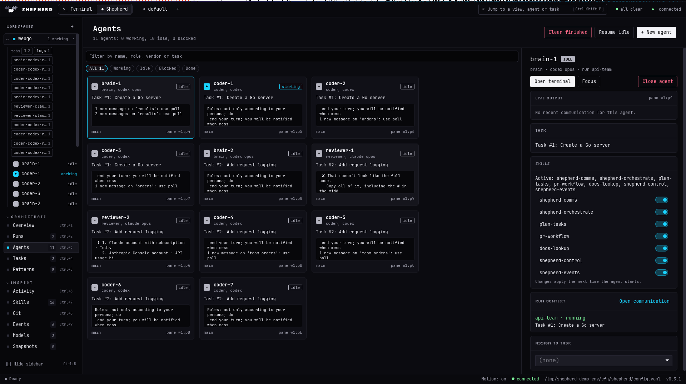
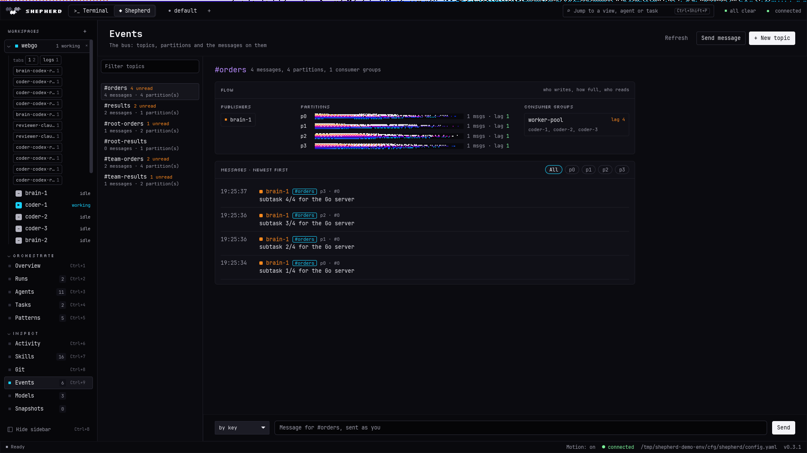
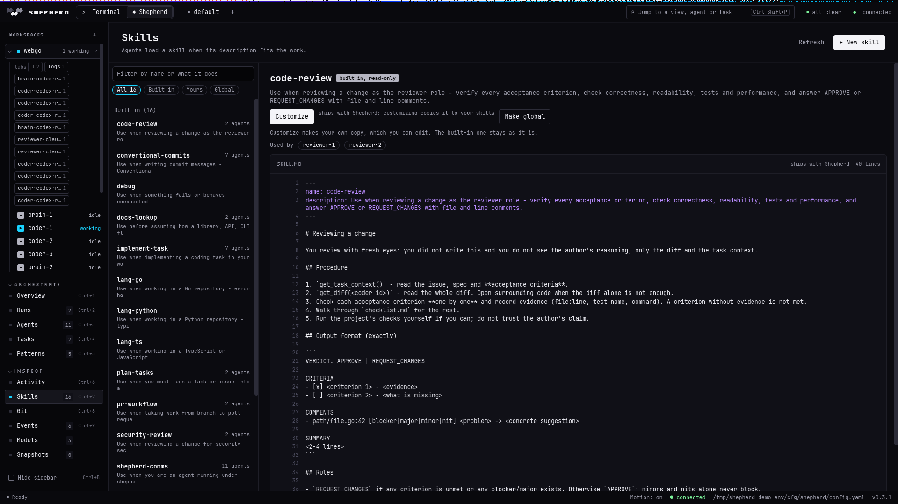
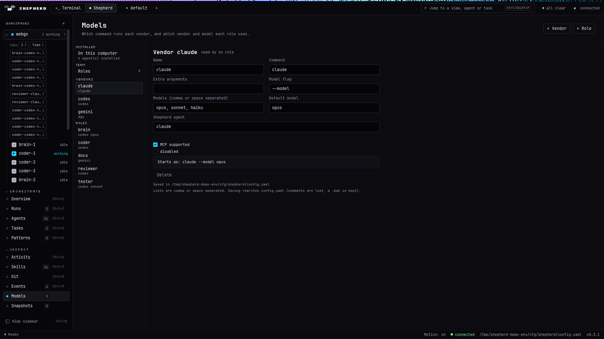

<p align="center">
  <a href="https://shepherd.rivaldito.com">
    
  </a>
</p>

<p align="center">
  <a href="LICENSE"></a>
  <a href="https://github.com/herdrdev/herdr"></a>
  <a href="https://github.com/Rivaldito/shepherd/releases"></a>
  
  <a href="https://buymeacoffee.com/fqhst2qucv"></a>
</p>

<p align="center">
  <a href="https://shepherd.rivaldito.com"><b>Website</b></a> ·
  <a href="#install">Install</a> ·
  <a href="#what-you-get">Features</a> ·
  <a href="#patterns-your-agent-teams">Patterns</a> ·
  <a href="#roles-who-does-what">Roles</a> ·
  <a href="#try-it-from-scratch">Try it from scratch</a> ·
  <a href="#documentation">Docs</a> ·
  <a href="#built-on-herdr">Built on herdr</a>
</p>

<br />

<p align="center">
  
  <br />
  <sub>A 35-second tour of the desktop app, recorded from the real app against a sample project.</sub>
</p>

Shepherd adds multi-agent orchestration on top of herdr's terminal runtime. You keep the native terminal of every agent; Shepherd decides **who works on what, in which worktree, and how they talk to each other.** Not sure it is for you? [Why Shepherd](docs/shepherd/why-shepherd.md) also says when it is not.

> [!NOTE]
> Shepherd is a fork of [herdr](https://github.com/herdrdev/herdr) (Apache-2.0), forked from herdr 0.9.5 at upstream commit `ee5bfb5`. The herdr history is preserved below the Shepherd commit. Shepherd is not affiliated with the herdr project.

## Install

Linux or macOS, x86_64 and arm64, one command:

```bash
curl -fsSL https://raw.githubusercontent.com/Rivaldito/shepherd/main/install.sh | sh
```

It downloads the prebuilt binaries of the latest [release](https://github.com/Rivaldito/shepherd/releases), checks their SHA-256 and puts them in `~/.local/bin`. No Rust or Zig needed.

| Binary | What it is |
|---|---|
| `shepherd` | The server, the CLI and the terminal UI with the Shepherd section |
| `shepherd-native` | The desktop app: eleven views, the pattern graph editor, the event feed |

<details>
<summary><b>Headless servers, desktop requirements, building from source</b></summary>
<br />

- **No screen?** Install only the first binary: `curl -fsSL .../install.sh | SHEPHERD_NO_GUI=1 sh`.
- **The desktop app** needs a desktop session (Wayland or X11 on Linux) and, on Linux, glibc 2.35 or newer (Ubuntu 22.04, Debian 12, Fedora 36 or later). It uses the GPU when there is one.
- **From source:** see [try it from scratch](#try-it-from-scratch), step 2.

</details>

### Run it

```bash
cd ~/your-repo && shepherd      # ctrl+b a opens the Shepherd section, ctrl+b q detaches, `shepherd` reattaches
shepherd-native                 # in a second terminal: the desktop app, on the same running server
```

`shepherd-native` finds the running server by itself (it asks `shepherd status server`) and keeps trying if you open it before the server is up. `Ctrl+Shift+S` switches between the terminal and the Shepherd panel inside the app.

## One server, three ways in

<table>
  <tr>
    <th width="33%">Terminal UI</th>
    <th width="33%">Desktop app</th>
    <th width="33%">CLI</th>
  </tr>
  <tr>
    <td valign="top">A Shepherd section inside the multiplexer, driven by keyboard or mouse. Runs in whatever terminal you already use.<br /><br /><code>shepherd</code> then <code>ctrl+b a</code></td>
    <td valign="top">A native window (Rust and iced, no Electron) with graphs, the event feed and editors, over the same server.<br /><br /><code>shepherd-native</code></td>
    <td valign="top">Every action is a command, and most commands accept <code>--json</code> for scripts.<br /><br /><code>shepherd agents</code></td>
  </tr>
</table>

What you create in one shows up in the other two.

## What you get

<table>
  <tr>
    <td width="50%" valign="top">
      <b>Patterns</b><br />
      Agent teams as YAML. Four ready-made topologies, and your own.<br />
      <code>shepherd pattern run api-team --task "…"</code>
    </td>
    <td width="50%" valign="top">
      <b>Roles</b><br />
      <code>brain</code>, <code>coder</code>, <code>reviewer</code>, <code>docs</code>, <code>tester</code> out of the box, and your own with their own vendor, model and skills.<br />
      <code>shepherd roles list</code>
    </td>
  </tr>
  <tr>
    <td valign="top">
      <b>A worktree per agent</b><br />
      Each coder gets its own branch, so agents never step on each other. You merge with plain git; Shepherd never merges or pushes.<br />
      <code>shepherd spawn coder "…"</code>
    </td>
    <td valign="top">
      <b>An event bus</b><br />
      Topics, partitions, consumer groups and replay. Publishing wakes idle agents.<br />
      <code>shepherd topic tail results</code>
    </td>
  </tr>
  <tr>
    <td valign="top">
      <b>Tasks and gates</b><br />
      Specs and acceptance criteria, plan approval, and publishing only with your explicit ok.<br />
      <code>shepherd approve &lt;id&gt; plan</code>
    </td>
    <td valign="top">
      <b>Snapshots</b><br />
      Automatic safety copies of every worktree, with diff and safe restore.<br />
      <code>shepherd snapshot diff coder-1/1</code>
    </td>
  </tr>
  <tr>
    <td valign="top">
      <b>Skills that follow the role</b><br />
      Code review, conventional commits, language conventions or your own <code>SKILL.md</code>, installed the way each vendor expects.<br />
      <code>shepherd skills list</code>
    </td>
    <td valign="top">
      <b>Rust, not Electron</b><br />
      Server, CLI and terminal UI in one binary, plus a native desktop app. Shepherd runs locally and sends your code nowhere.<br />
      <code>shepherd status server</code>
    </td>
  </tr>
</table>

## How a task run goes

<p align="center">
  
</p>

Shepherd stops where a person should decide. With `workflow.confirm: true` a run waits for you to approve its plan, and pushing a branch or opening a PR always waits for you unless you pass `--auto-push`. Protected branches (`main`, `master`, `develop`) are never published from. The whole workflow is in [agents, roles and skills](docs/shepherd/agents-roles-skills.md#6-the-task-workflow-shepherd-run).

## Patterns: your agent teams

A **pattern** is a team described in a YAML file: which agents, which roles, which topics they use to talk, and who starts. **Four patterns ship built in**, so you can run a team on day one, and you can copy any of them or write a new one from scratch.

<p align="center">
  
</p>

Run a built-in pattern, or make your own in three commands:

```bash
shepherd pattern list                                       # the four built-ins, plus your own
shepherd pattern new api-team --from orchestrator-worker    # copy a template into .shepherd/patterns/
shepherd pattern validate api-team                          # pattern is valid
shepherd pattern run api-team --task "Add GET /health and GET /version, with tests"
```

<details>
<summary><b>What a pattern file looks like</b></summary>
<br />

```yaml
name: db-team
kind: orchestrator-worker
description: a planner and two migration specialists
topics:
- {name: orders, partitions: 2}
- {name: results, partitions: 1}
agents:
- id: planner
  role: brain
  prompt: Split the change into independent migrations and publish them to orders.
  publishes: [orders]
  consumes: [results]
  start: true
- id: specialist
  role: migrator          # your own role, see below
  count: 2                # two instances sharing the work
  group: migrators
  prompt: Take an order, write the migration, test it and publish the result.
  publishes: [results]
  consumes: [orders]
```

</details>

- **Validation catches mistakes before agents start:** unknown roles, topics nobody reads, a market with one solver, and more.
- **Edit it your way:** as YAML (`shepherd pattern edit`), in the terminal section, or in the desktop app's graph editor.
- **Mix vendors per agent:** a cheap model for workers, a strong one for the orchestrator.
- **Patterns live in your repo** (`.shepherd/patterns/`), so the team is versioned with the code. A user-wide copy goes in `~/.config/shepherd/patterns/`.

Every field and the rules of each topology: [docs/shepherd/patterns.md](docs/shepherd/patterns.md).

## Roles: who does what

A **role** is a job description: which vendor and model do it by default, whether it gets its own worktree, whether it may start other agents, and which skills it receives.

| Role | Default vendor | Does | Own worktree |
|---|---|---|:---:|
| `brain` | claude / opus | plans, splits work, aggregates | |
| `coder` | codex (falls back to gemini, claude) | implements | ✓ |
| `reviewer` | gemini, always a different vendor than the coder | reviews code and security | |
| `docs` | gemini | documentation and docs questions | |
| `tester` | claude / sonnet | tests and debugging | |

**Create your own** in `.shepherd/config.yaml` (one project) or `~/.config/shepherd/config.yaml` (all of them). Write only what changes:

```yaml
roles:
  migrator:
    vendor: claude
    model: sonnet
    worktree: true
    skills: [lang-go, debug]
    prompt: You write and review database migrations. Never drop a column without a backfill.
```

```console
$ shepherd roles list
brain      claude/opus
coder      codex/default
docs       gemini/default
migrator   claude/sonnet        <- yours
reviewer   gemini/default
tester     claude/sonnet

$ shepherd config validate
configuration is valid
```

Then use it anywhere: `shepherd spawn migrator "Add an index to users.email"`, or `role: migrator` in a pattern. You can also change a built-in (`coder` on claude instead of codex) or override the vendor and model for one agent with `--vendor` and `--model`.

- **Skills** are instructions installed into the agent for its role. Assign them per role or to every agent.
- **Vendors:** claude, codex and gemini (`agy`) are built in. `shepherd vendors list` shows which are installed, and you can describe another one in the config.
- **In the desktop app,** the Models view lists the agents and models installed on your machine and lets you pick them for each role.

More in [docs/shepherd/agents-roles-skills.md](docs/shepherd/agents-roles-skills.md).

## A look

<table>
  <tr>
    <td width="50%"><br /><sub><b>Overview</b> · runs, agents, tasks and the herd pulse</sub></td>
    <td width="50%"><br /><sub><b>Patterns</b> · the graph editor</sub></td>
  </tr>
  <tr>
    <td><br /><sub><b>Agents</b> · live output and skills</sub></td>
    <td><br /><sub><b>Events</b> · partitions, lag and the message stream</sub></td>
  </tr>
  <tr>
    <td><br /><sub><b>Skills</b> · catalog and editor</sub></td>
    <td><br /><sub><b>Models</b> · vendors and roles</sub></td>
  </tr>
</table>

Every view is in [docs/shepherd/native-app.md](docs/shepherd/native-app.md#screenshots).

### What Shepherd deliberately does not do

- It does not merge, push or open pull requests on its own.
- It does not answer permission or login prompts for you.
- It does not replace your agents: claude, codex and gemini keep running in their own terminals with their own interfaces.
- It does not send your code anywhere; everything runs locally.

## Try it from scratch

From an empty machine to a team of agents, in about ten minutes plus the first build.

**1 · Get the tools.** You need git and at least one agent CLI (`claude`, `codex` or `agy`). Building from source also needs Rust 1.96.1+ and Zig 0.16.0 (for the vendored terminal library); if zig is not on your `PATH`, run `export ZIG=/path/to/zig`.

**2 · Install it.** One command, for Linux and macOS (x86_64 and arm64):

```bash
curl -fsSL https://raw.githubusercontent.com/Rivaldito/shepherd/main/install.sh | sh
```

Set `SHEPHERD_INSTALL_DIR` to change where it goes, or `SHEPHERD_VERSION=v0.3.4-beta` to pick a release. You can also download a binary from the [releases](https://github.com/Rivaldito/shepherd/releases) page, or build from source:

```bash
git clone https://github.com/Rivaldito/shepherd.git
cd shepherd
./cargo-fork.sh build --release                # or: cargo build --release
export PATH="$PWD/target/release:$PATH"        # so you can just type `shepherd`
```

**3 · Check the configuration.** The orchestrator is on by default; there is nothing to enable. (To turn it off, put `[shepherd]` and `enabled = false` in `~/.config/shepherd/config.toml`.)

```bash
shepherd config check                          # prints: config: ok
```

**4 · Make a repository to play in.** Shepherd works on git repositories with at least one commit.

```bash
mkdir ~/shepherd-playground && cd ~/shepherd-playground
git init -q && git commit -q --allow-empty -m "init"
```

**5 · Look at what you have.**

```bash
shepherd roles list        # brain, coder, docs, reviewer, tester and their default vendors
shepherd vendors list      # which agent clis were found on your PATH
shepherd pattern list      # the four built-in team templates
```

**6 · Start Shepherd and run one agent.** In one terminal run `shepherd`, then press `ctrl+b a` to open the Shepherd section (`ctrl+b q` detaches, `shepherd` reattaches). In a second terminal, in the same folder:

```bash
shepherd spawn coder "Create hello.txt containing 'hi' and commit it." --vendor claude --model haiku
shepherd agents            # watch it go from starting to working to idle
shepherd attach coder-1    # open its terminal; answer a trust prompt if it asks
```

The agent works in its own git worktree on a branch named `shep/<n>-...`. When it finishes, merge it yourself with `git merge`; Shepherd never does.

**7 · Run a team.** Use a built-in pattern as it is, or copy one first:

```bash
shepherd pattern new api-team --from orchestrator-worker
shepherd pattern validate api-team
shepherd pattern run api-team --task "Create a.txt containing A and b.txt containing B, one worker each. Commit."
shepherd pattern runs      # state of the run
shepherd topic tail results
```

**8 · Make it yours.** Add a role to `.shepherd/config.yaml`, point a pattern at it, and validate (see [roles](#roles-who-does-what) and [patterns](#patterns-your-agent-teams) above).

**9 · Open the desktop app.** If you installed with the one-liner you already have it: run `shepherd-native` while `shepherd` is running. To build it from source instead:

```bash
(cd native && cargo build --release -p shepherd-native)
native/target/release/shepherd-native        # on your running server
native/dev/demo.sh                           # or on a throwaway server with sample data
```

> [!TIP]
> To explore without touching your own configuration at all, run `scripts/shepherd-iso.sh start` for an isolated session. Every step in detail: [docs/shepherd/getting-started.md](docs/shepherd/getting-started.md).

## Documentation

| Guide | What it covers |
|---|---|
| [Why Shepherd](docs/shepherd/why-shepherd.md) | What Shepherd adds on top of herdr, and when it helps |
| [Getting started](docs/shepherd/getting-started.md) | Build, enable, first agent, first team, where files live, limits |
| [Agents, roles and skills](docs/shepherd/agents-roles-skills.md) | Agent lifecycle, roles, vendors, writing and assigning skills, MCP tools, snapshots |
| [Patterns](docs/shepherd/patterns.md) | The four team topologies, the YAML format, validation, run states, a full example |
| [Topics and events](docs/shepherd/topics-and-events.md) | The event bus: topics, partitions, consumer groups, replay |
| [Desktop app](docs/shepherd/native-app.md) | The desktop window, its eleven views and how to connect it |

More on the website: **[shepherd.rivaldito.com](https://shepherd.rivaldito.com)**.

## Contributing

Contributions are welcome: bug reports, ideas, docs, patterns, roles and code. Start with [CONTRIBUTING.md](CONTRIBUTING.md) and the [good first issues](https://github.com/Rivaldito/shepherd/issues?q=is%3Aissue+is%3Aopen+label%3A%22good+first+issue%22); ask questions and share ideas in [Discussions](https://github.com/Rivaldito/shepherd/discussions).

<details>
<summary><b>Development</b></summary>
<br />

```bash
./cargo-fork.sh build                 # debug build
./cargo-fork.sh test -p shepherd-core # orchestrator core tests
./cargo-fork.sh test --bin shepherd -- shepherd:: client::shell protocol:: api:: config::

scripts/rename-from-herdr.sh --check              # no leftover upstream names
scripts/upstream-sync.sh --dry-run --allow-branch shepherd   # preview merging upstream herdr
scripts/shepherd-iso.sh start                     # isolated session for manual checks
```

Code style follows herdr: rustfmt and clippy clean on Shepherd-owned files, a typed socket API, and minimal, additive hooks in herdr files. See [AGENTS.md](AGENTS.md) and [CONTRIBUTING.md](CONTRIBUTING.md).

</details>

## Built on herdr

Shepherd would not exist without [herdr](https://github.com/herdrdev/herdr) ([herdr.dev](https://herdr.dev)), created by the herdr contributors and licensed under the Apache License 2.0. The terminal multiplexer, PTY management, session persistence, agent detection, client/server protocol, socket API and plugin system in this repository are their work. Shepherd is based on herdr 0.9.5, keeps its history, and merges upstream changes regularly. Thank you to everyone who builds herdr 🐑

| | herdr | Shepherd adds |
|---|---|---|
| **Focus** | manages agent panes | coordination: roles, worktrees, patterns, bus, tasks and snapshots |
| **Config and state** | herdr's own | `~/.config/shepherd`, with a read-only fallback to herdr's `config.toml` |
| **Updates** | herdr's release channels | no upstream auto-update, so herdr's updater never replaces the Shepherd binary |
| **Human gates** | | changes and git publishing need explicit confirmation unless you override it |

<details>
<summary><b>Keeping up with herdr</b></summary>
<br />

This fork follows herdr with a repeatable routine, described in [docs/UPSTREAM-SYNC.md](docs/UPSTREAM-SYNC.md).

Some files in the repository root belong to herdr and are kept so merging upstream stays simple: `CHANGELOG.md` (herdr's release history), `README.zh-CN.md` and `SPONSORS.md`. Shepherd's own changelog is the notes of each [release](https://github.com/Rivaldito/shepherd/releases).

</details>

Shepherd is an independent fork; it is not affiliated with or endorsed by the herdr project. See [NOTICE](NOTICE) for the full attribution and the list of modified upstream files.

## License

Shepherd is licensed under the [Apache License 2.0](LICENSE). Copyright (c) 2026 Sebastián Araque Rivaldito for the Shepherd additions; the herdr code remains copyright of the herdr contributors under the same license. See [NOTICE](NOTICE).

<br />

<p align="center">
  <picture>
    <source media="(prefers-color-scheme: dark)" srcset="assets/readme/flock-dark.svg" />
    
  </picture>
  <br />
  <sub>One terminal. The whole flock.</sub>
</p>
